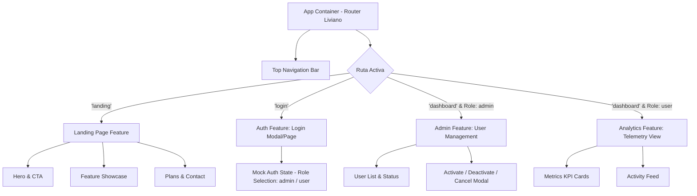
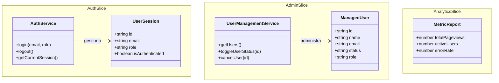

# 🏛️ ADR 001: Arquitectura de Frontend React con Vertical Slicing y Control de Acceso por Roles (RBAC)

**Fecha:** 2026-10-22  
**Estado:** Propuesto (Pendiente de Aprobación)  
**Autor:** Agente 2 (Staff Software Architect)  

---

## 1. Contexto y Problema
El frontend de Counter requiere evolucionar de páginas HTML estáticas a una Single Page Application (SPA) reactiva y modular que contemple:
1. Una **Landing Page pública** atractiva e informativa para la presentación de la plataforma de analítica.
2. Un **Panel Administrativo protegido** con simulación de sesión y dos roles de usuario:
   - `admin`: Capacidad para activar, suspender o cancelar cuentas de usuarios.
   - `user`: Visualización de métricas analíticas e historial personal.
3. El código debe adherirse al principio de diseño por rebanadas verticales (Vertical Slicing), POO/tipado estricto y un límite estricto de **150 líneas por archivo**.

---

## 2. Diagrama de Arquitectura y Navegación

---

## 3. Diagrama de Rebanadas Verticales (Vertical Slicing)

---

## 4. Decisiones Técnicas Adoptadas

1. **Framework Core:** React 19 + TypeScript sobre Vite para rendimiento óptimo, recarga en caliente instantánea y tipado rígido.
2. **Estilos:** Vanilla CSS con variables CSS `:root` y diseño de componentes atómicos claros (Light Theme 2026).
3. **Manejo de Estado Front-End:** Context API desacoplado y servicios TypeScript con inyección de dependencias para simular la persistencia en memoria previo a la integración con el backend Flask.
4. **Límite de Líneas:** Modularización estricta respetando <= 150 líneas por archivo.
