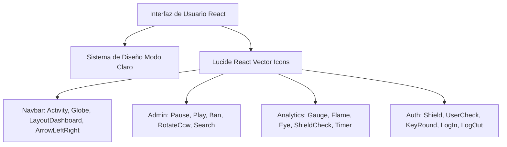

# 🏛️ ADR 002: Estandarización de Iconografía Vectorial (Lucide) y Estética Enterprise SaaS

**Fecha:** 2026-10-22  
**Estado:** Propuesto (Pendiente de Aprobación)  
**Autor:** Agente 2 (Staff Software Architect)  

---

## 1. Decisión de Diseño
Sustituir la totalidad de glifos emoji por iconos vectoriales del paquete `lucide-react`, estructurando una interfaz sobria en modo claro, con una jerarquía visual orientada a clientes corporativos.

---

## 2. Consecuencias
- **Positivas:** Apariencia seria y profesional, mejor consistencia geométrica, accesibilidad visual mejorada mediante SVGs escalables y soporte para temas claros sin artefactos de renderizado de fuentes del sistema operativo.
- **Límite de Líneas:** Cada archivo se mantendrá estrictamente por debajo de las 150 líneas mediante composición.
