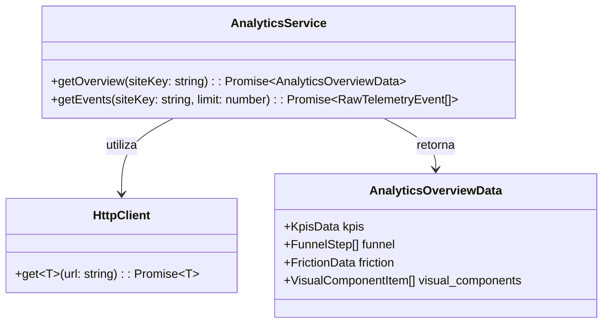

# 🏛️ ADR 003: Contratos de Dominio Analítico 360° y Cliente HTTP Nativo

**Fecha:** 2026-10-22  
**Estado:** Propuesto (Pendiente de Aprobación)  
**Autor:** Agente 2 (Staff Software Architect)  

---

## 1. Decisión de Arquitectura
1. Implementar un cliente HTTP base en `src/core/http/http_client.ts` utilizando la API `fetch` nativa sin SDKs externos.
2. Modelar formalmente las entidades del backend Flask (`kpis`, `funnel`, `friction`, `visual_components`) en la capa `domain/` de analítica.
3. Descomponer el dashboard de analítica en 5 componentes atómicos independientes de visualización para asegurar que ningún archivo exceda las 150 líneas.

