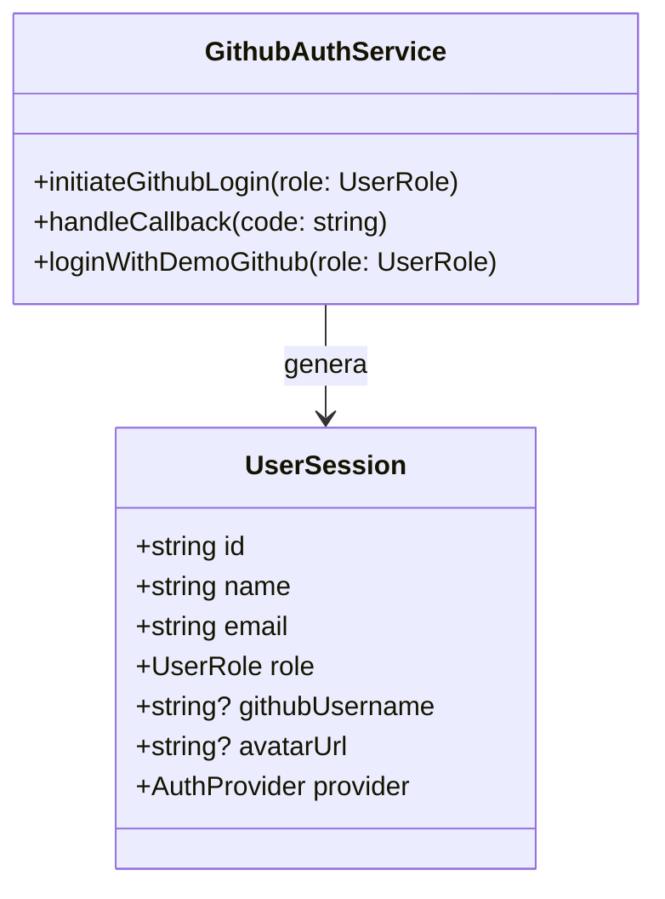

# 🏛️ ADR 004: Arquitectura de Autenticación con GitHub OAuth 2.0 Desacoplada

**Fecha:** 2026-10-22  
**Estado:** Propuesto (Pendiente de Aprobación)  
**Autor:** Agente 2 (Staff Software Architect)  

---

## 1. Contexto
Se requiere habilitar el acceso a la plataforma Counter mediante proveedores de identidad externos (Social Login), priorizando **GitHub** para el ecosistema de desarrolladores y analistas técnicos.

---

## 2. Decisión Arquitectónica
- Diseñar el flujo OAuth 2.0 desacoplado respetando la **Regla 2.3** (sin SDKs comerciales pesados como Firebase o Auth0).
- Utilizar peticiones HTTP REST nativas y soporte dual:
  1. Configuración de `VITE_GITHUB_CLIENT_ID` para redirección a `https://github.com/login/oauth/authorize`.
  2. Modo Demo/Simulación que inyecta el perfil de GitHub (`https://github.com/DavidSolorza.png`) para pruebas directas en el navegador sin bloquear el entorno de desarrollo local.
- Respetar el límite de 150 líneas por archivo aislando el botón de GitHub, el servicio de autenticación y los adaptadores de perfil.

---

## 3. Diagrama de Clases y Entidades

