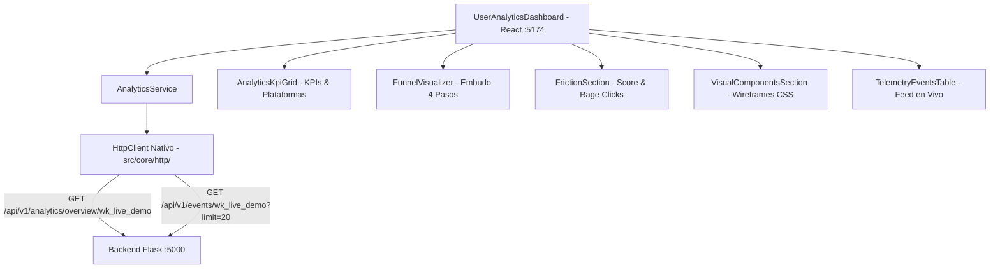

# 📋 Propuesta Técnica: Integración de Analítica Avanzada 360° y Contratos REST

**ID:** PROP-2026-003  
**Autor:** Agente 1 (VP of Engineering) & Agente 2 (Staff Software Architect)  
**Estado:** PENDIENTE DE APROBACIÓN DEL USUARIO  
**Fecha:** 2026-10-22  

---

## 1. Contexto y Requerimiento
El backend Flask (`http://localhost:5000`) completó la implementación de motores de analítica avanzada (Commit cfec186):
- Embudo de conversión de 4 etapas (`FunnelProcessor`).
- Análisis de fricción y rage clicks (`FrictionAnalyzer`).
- Componentes visuales y wireframing (`VisualWireframe`).
- Métricas de sesión, rebote y dwell time (`SessionMetrics`).
- Ingesta y catálogo de licencias (`security.db` y `analytics.db`).

Se solicita ajustar el frontend React para consumir y representar estos datos de manera organizada, ejecutiva y profesional, respetando el modo claro, iconografía Lucide y el límite de 150 líneas por archivo.

---

## 2. Arquitectura de Integración (Vertical Slicing)

---

## 3. Desglose de Componentes a Implementar

1. **Cliente HTTP Nativo (`src/core/http/http_client.ts`):**  
   Cumplimiento de la Regla 2.3 (sin SDKs comerciales opacos). Utiliza `fetch` estándar con control de timeout, cabeceras JSON y control tipado de excepciones de red.
2. **Contratos de Dominio (`src/features/analytics/domain/analytics_types.ts`):**  
   Tipado estricto de `AnalyticsOverviewResponse`, `FunnelStep`, `FrictionData`, `VisualComponentItem` y `RawTelemetryEvent`.
3. **Servicio de Aplicación (`src/features/analytics/application/analytics_service.ts`):**  
   Orquestación de peticiones a `http://localhost:5000/api/v1/analytics/overview/<site_key>` con fallback reactivo seguro en caso de corte temporal de red.
4. **Módulos de Presentación Atómicos (< 150 líneas):**
   - `AnalyticsKpiGrid.tsx` & `.css`: Total eventos (113), sesiones activas (1), rebote (0.0%), dwell time (21s) y desglose de navegador/OS.
   - `FunnelVisualizer.tsx` & `.css`: Los 4 pasos del embudo con barras de progreso de conversión y drop-off rate.
   - `FrictionSection.tsx` & `.css`: UX Friction Score (30/100, Crítico), hotspots de rage clicks (FAQ headers, botones) y tabla de errores de React/JS con número de línea.
   - `VisualComponentsSection.tsx` & `.css`: Renderizado visual con los estilos CSS reales capturados (`backgroundColor`, `color`, `borderRadius`), clicks totales y engagement share %.
   - `TelemetryEventsTable.tsx`: Feed en tiempo real con datos de red e IP local.

---

## 4. Garantía de Gobernanza
- **Límite <= 150 líneas:** Cada subsección tendrá su propio archivo `.tsx` y `.css`.
- **Cero Emojis:** Iconos de `lucide-react` (`TrendingUp`, `Flame`, `Eye`, `AlertTriangle`, `Gauge`, `Layers`, `Monitor`).
