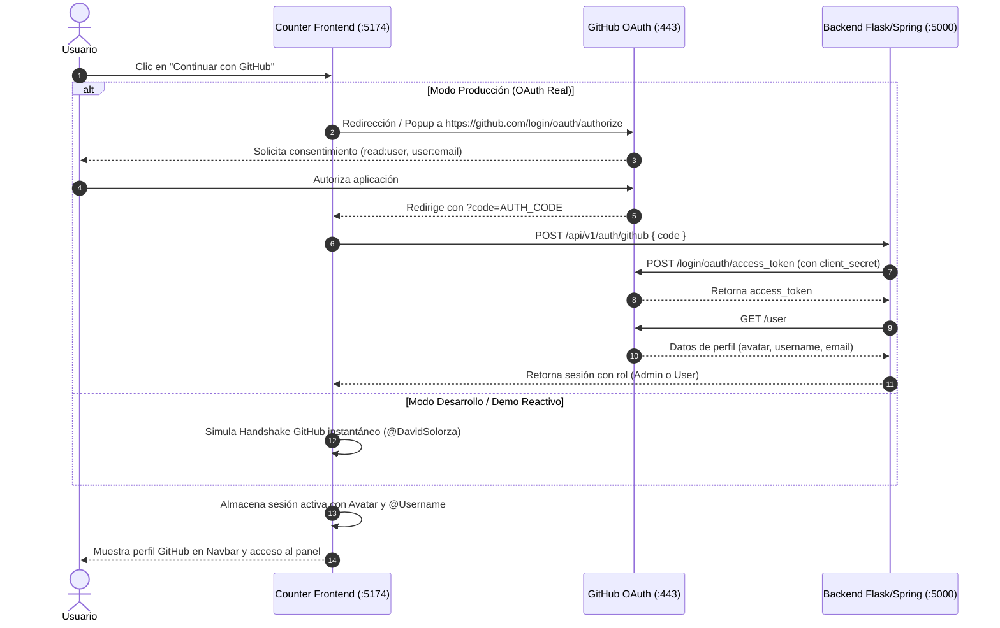

# 📋 Propuesta Técnica: Integración de Autenticación con GitHub (OAuth 2.0)

**ID:** PROP-2026-004  
**Autor:** Agente 1 (VP of Engineering) & Agente 2 (Staff Software Architect)  
**Estado:** PENDIENTE DE APROBACIÓN DEL USUARIO  
**Fecha:** 2026-10-22  

---

## 1. Contexto y Objetivos

El usuario ha solicitado incorporar inicio de sesión con **GitHub** en la plataforma Counter-Front. Esta funcionalidad aportará:
1. Una experiencia de acceso rápido y confiable para ingenieros y administradores.
2. Identidad verificada con avatar, nombre de usuario (`@usuario`) y correo institucional de GitHub.
3. Compatibilidad con el estándar OAuth 2.0 desacoplado (Frontend + Backend), sin librerías comerciales pesadas (Regla 2.3).

---

## 2. Flujo de Autenticación Propuesto

---

## 3. Componentes y Modificaciones Arquitectónicas

1. **Ampliación del Dominio de Sesión (`src/features/auth/domain/user_session.ts`):**
   - Incorporar campos `githubUsername?: string`, `avatarUrl?: string`, y `provider: 'local' | 'github'`.
2. **Botón Corporativo GitHub (`src/features/auth/infrastructure/GithubLoginButton.tsx` & `.css`):**
   - Botón oficial en modo claro con icono SVG vectorial de GitHub, estado loading y feedback táctil.
3. **Manejador de Callback / Simulación (`src/features/auth/application/github_auth_service.ts`):**
   - Orquestador del flujo OAuth: apertura de ventana emergente, captura de código o ingreso demo con perfil de GitHub (`DavidSolorza`).
4. **Actualización de `LoginForm.tsx` & `Navbar.tsx`:**
   - Inclusión del botón de GitHub como método de acceso primario.
   - En la Navbar, renderizado del avatar real de GitHub y badge `@usuario`.
5. **Cumplimiento Estricto de Gobernanza:**
   - Todo archivo se mantendrá estrictamente por debajo de **150 líneas**.

---

## 4. Próximos Pasos

1. Evaluación y visto bueno del usuario.
2. Implementación de los contratos y componentes de GitHub Login.
3. Pruebas y validación en navegador.
4. Commit y Push final a `origin/main`.
