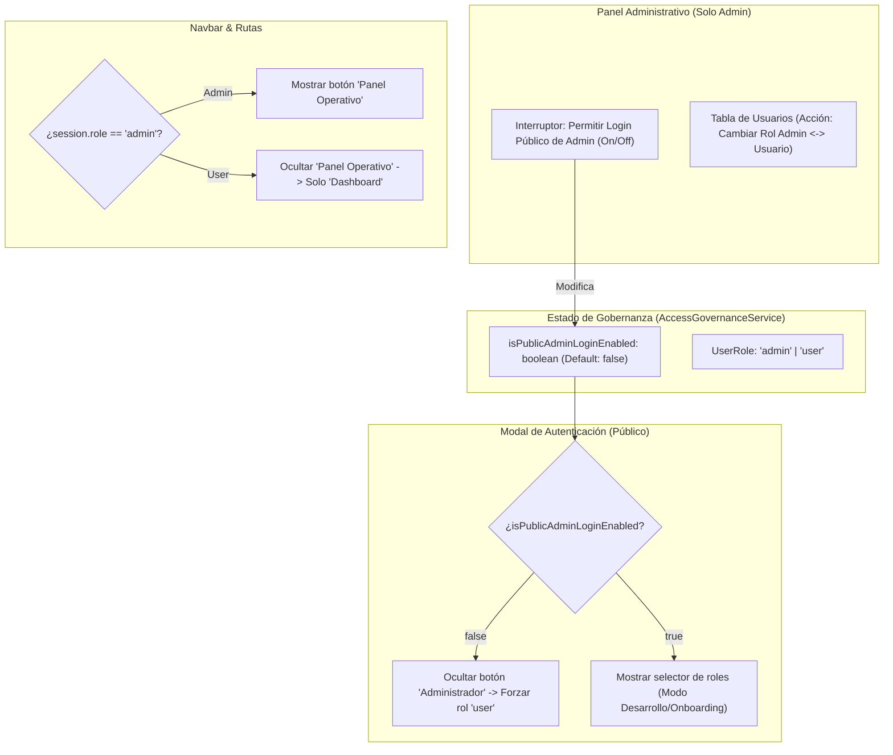

# Propuesta Técnica: Gobernanza de Roles, Permisos Estrictos y Control de Acceso Administrativo

- **ID:** PROP-013  
- **Fecha:** 2026-10-22  
- **Autor:** VP of Engineering & Software Architect  
- **Estado:** PENDIENTE DE APROBACIÓN (Fase 2 de Gobernanza Antigravity)  
- **Módulos Afectados:**  
  - `src/features/auth/` (LoginForm, RoleSelector, auth_context)  
  - `src/features/admin/` (AdminPanel, UserTable, UserTableRow, user_management_service)  
  - `src/core/layout/` (Navbar)  

---

## 1. Justificación y Problema de Seguridad
Actualmente, el Frontend cuenta con selectores de rol públicos de prueba ("Demo Admin", botones de alternancia en Navbar y RoleSelector en el modal de login) que permiten que cualquier visitante o nuevo usuario se asigne a sí mismo el rol de `admin`.

### Requerimiento de Negocio:
1. **Control Maestro de Visibilidad:** En el Panel Administrativo debe existir un interruptor (*"Mostrar / Ocultar botón de Iniciar Sesión como Admin"*). Si está apagado, nadie desde el exterior puede iniciar sesión como admin ni ver atajos administrativos.
2. **Principio de Administrador Único:** Solo puede haber un admin inicial, y ningún usuario nuevo puede ser admin a menos que un admin existente le cambie explícitamente el rol desde la tabla de usuarios.
3. **Blindaje de Vistas y Permisos:** Si un usuario tiene rol `user`, solo puede ver su propio dashboard de telemetría y métricas. No puede acceder al Panel Administrativo ni alterar licencias ni Kill-Switches.

---

## 2. Arquitectura de Solución Propuesta

---

## 3. Especificación de Componentes a Desarrollar

### 3.1. Servicio de Gobernanza de Acceso (`access_governance_service.ts`)
- Gestiona el estado reactivo de `allowPublicAdminLogin` (persistido en `localStorage` con fallback seguro en `false`).
- Expone:
  - `isPublicAdminLoginEnabled(): boolean`
  - `setPublicAdminLoginEnabled(enabled: boolean): void`
  - `canChangeRole(currentUserRole: UserRole, targetUser: ManagedUser): boolean`

### 3.2. Interruptor en el Panel Administrativo (`AdminAccessControlCard.tsx`)
- Nueva tarjeta en el encabezado del AdminPanel:
  - Título: **Gobernanza de Acceso y Puerta Administrativa**
  - Toggle Switch elegante: *"Permitir inicio de sesión público como Administrador"*
  - Indicador de estado: *"Protegido: Nuevos usuarios solo pueden ingresar como analistas"*

### 3.3. Restricción en Modal de Login (`RoleSelector.tsx` y `LoginForm.tsx`)
- Si `isPublicAdminLoginEnabled` es `false`:
  - `RoleSelector` oculta la pestaña de "Administrador" y los atajos "Demo Admin".
  - Por defecto, todos los formularios asignan `role: 'user'`.
  - El botón de GitHub y Google autentica automáticamente como `user`.

### 3.4. Gestión de Roles en la Tabla de Usuarios (`UserTableRow.tsx`)
- Nueva columna o acción: **Cambiar Rol** (icono `ShieldAlert` o `ShieldCheck`).
- Al hacer clic, un admin puede:
  - Promover un `user` a `admin`.
  - Degradar un `admin` a `user` (con validación: no se puede degradar a sí mismo si es el último admin).
- El cambio persiste en `user_management_service` y en Spring Boot.

### 3.5. Limpieza y Protección en `Navbar.tsx`
- Si el usuario logueado no es `admin`, se ocultan los botones de "Vista Admin (Gestión)" y el acceso directo al Panel Operativo.

---

## 4. Auditoría de Límites (< 150 líneas)
- Todos los nuevos submódulos (`access_governance_service.ts`, `AdminAccessControlCard.tsx`) se crearán con responsabilidades atómicas para mantenerse entre 40 y 90 líneas de código.
